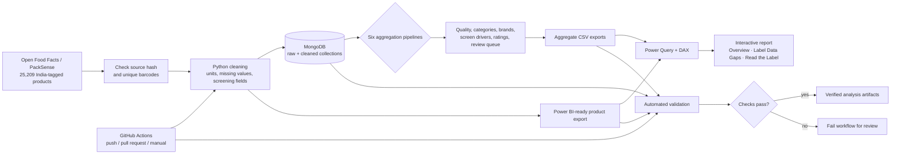
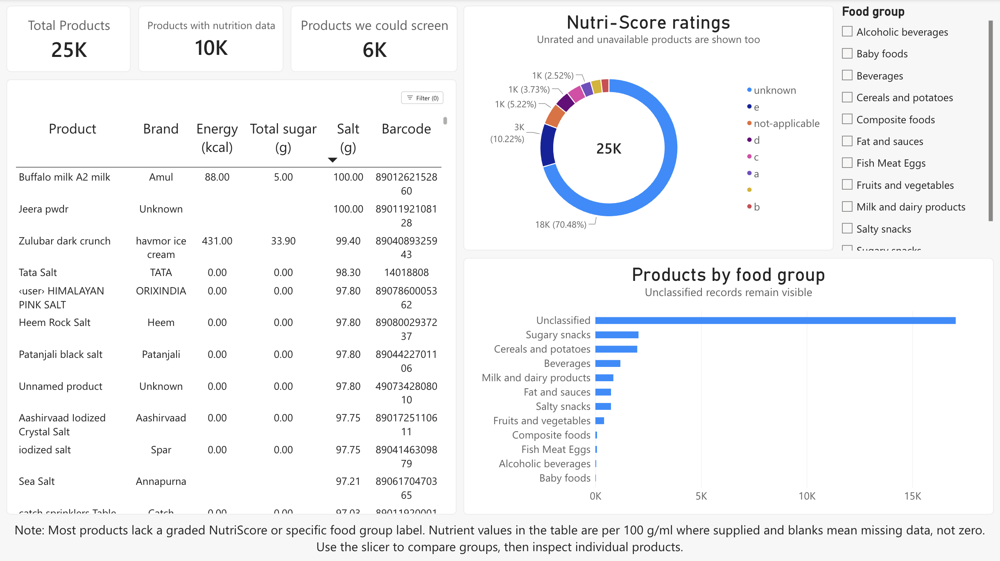
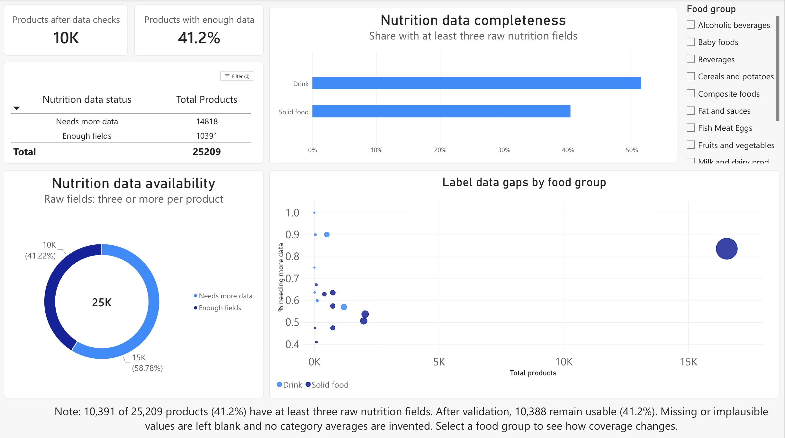
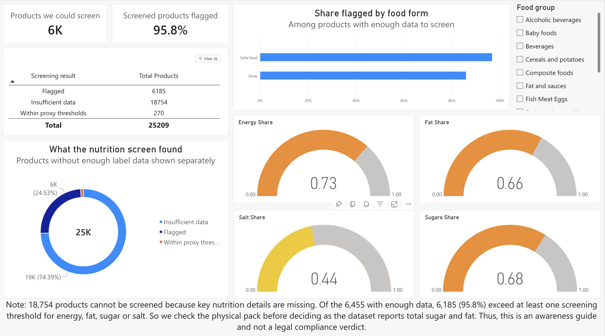

# Indian packaged food nutrition analysis

Reproducible analysis of **25,209 India-tagged products** from the Open Food Facts-derived [PackSense snapshot](https://huggingface.co/datasets/PackSense/packsense-india), released 3 November 2026. The project uses Python, local MongoDB, six aggregation pipelines, a Power Query model, and DAX measures.

**Start here:** [interactive Power BI report](https://app.powerbi.com/groups/me/reports/81154722-4843-4b7f-8450-4bd92a2afa2c/a87cf5130da9a7606572?experience=power-bi) · [workflow diagram and CI](WORKFLOW.md) · [validation record](VALIDATION.md).

## Workflow at a glance



The executable steps and trigger details are in [WORKFLOW.md](WORKFLOW.md) and [the GitHub Actions workflow](.github/workflows/verify.yml).

## Verified results

| Measure | Count | Share of all products |
|---|---:|---:|
| Products loaded | 25,209 | 100.0% |
| Raw usable: named product and at least 3 of 6 nutrition fields | 10,391 | 41.2% |
| Usable after validation and unit conversion | 10,388 | 41.2% |
| Eligible for the four-input HFSS proxy screen | 6,455 | 25.6% |
| Flagged among eligible products | 6,185 | 95.8% of eligible |

Missing nutrition values were not invented or filled with category averages. The source includes non-food and incomplete records, so this is a catalogue analysis, not a census of Indian packaged foods.

## Run locally

```bash
python3 -m venv .venv
.venv/bin/pip install -r requirements.txt
.venv/bin/python build.py --source india_products.csv --mongo mongodb://localhost:27017
.venv/bin/python verify.py
```

The command replaces the `raw_products` and `products` collections in the `indian_packaged_food_nutrition` database. It writes `dashboard_products.csv`, six CSV files in `aggregates/`, and `run_metrics.json`.

## Six MongoDB aggregations

1. `quality_overview`: coverage and validation audit.
2. `category_profile`: category counts, nutrient averages, and screen rates.
3. `brand_scorecard`: brand counts and screen rates with a minimum 20-product denominator.
4. `hfss_drivers`: number of eligible products above each proxy threshold.
5. `nutriscore_screen`: Nutri-Score by proxy-screen status.
6. `review_queue`: 100 high-energy flagged products for label review.

The executable definitions are in `aggregations.py`.

## HFSS screen and limits

The screen uses the [ICMR-NIN 2024 Dietary Guidelines, Table 15.1](https://www.nin.res.in/dietaryguidelines/pdfjs/locale/DGI07052024P.pdf): energy 250 kcal, added fat 4.2 g, added sugar 3 g, and salt 0.625 g per 100 g for solids; 70 kcal, 1.5 g, 2 g, and 0.175 g per 100 ml for liquids. The source lacks consistent **added** fat and **added** sugar, so total fat and total sugar are used as deliberately conservative proxies. A product is screened only when the source explicitly states a 100 g or 100 ml basis, is marked as sold, and contains all four inputs. **“Flagged” is not a legal compliance determination.** It means at least one proxy threshold was exceeded and needs review against the physical label and applicable law.

Energy is converted from kJ only when kcal is absent; salt is derived from sodium using salt = sodium × 2.5 only when salt is absent. Implausible values are set to missing. Averages exclude missing nutrient values. Products with incomplete inputs remain “Insufficient data.”

## Live Power BI report

[Open the three-page interactive report](https://app.powerbi.com/groups/me/reports/81154722-4843-4b7f-8450-4bd92a2afa2c/a87cf5130da9a7606572?experience=power-bi) in the owner's Power BI workspace. It uses a `Products` semantic model populated by `power_query.m`. The report is private to the Power BI account unless its owner shares it.

| Page | Main visuals and interaction |
|---|---|
| 01 Overview | Product, nutrition-data, and screenable-product cards; food-group bar chart; Nutri-Score distribution; product-level nutrition table; food-group slicer. |
| 02 Label Data Gaps | Validated-product count and nutrition-data-coverage cards; availability donut; exact count table; drink-versus-solid comparison; food-group slicer. |
| 03 Read the Label | Screened-products and flagged-share cards; outcome donut, exact count table, solid-food/drink comparison; food-group slicer; consumer-awareness note. |

The report's installed DAX measures are `Total Products`, `Raw Usable Products`, `Raw Usable Share`, `Normalized Usable Products`, `Screen Eligible Products`, `Flagged Products`, `Within Proxy Thresholds`, `Insufficient Data Products`, and `Flagged Share of Eligible`. `measures.dax` also includes optional measures for extending the report. The title and subtitle text, full-snapshot notes, and count tables should be read together when filtering: static explanatory counts refer to all 25,209 source rows.

To rebuild the model in another Power BI workspace, create a Blank Query and paste `power_query.m` into Advanced Editor, then add the desired expressions from `measures.dax` as separate measures. The public CSV URL is embedded in the query, and Power BI needs anonymous Web access to that URL. Alternatively, import `dashboard_products.csv` and map the field names.

## Source and licence

Data: Open Food Facts contributors, ODbL 1.0, via PackSense's India snapshot. The redistributed source and transformed CSVs remain under ODbL 1.0. The snapshot is crowd sourced and not independently verified against packaging. See the [PackSense dataset card](https://huggingface.co/datasets/PackSense/packsense-india) and [Open Food Facts API and reuse documentation](https://openfoodfacts.github.io/documentation/docs/Product-Opener/api/).

## Power BI page screenshots

These captures show the saved Power BI report at the full-snapshot filter state. The live report supports food-group slicers and cross-filtering.

<a id="page1"></a>
### Page 1 · Overview



<a id="page2"></a>
### Page 2 · Label data gaps



<a id="page3"></a>
### Page 3 · Read the label


