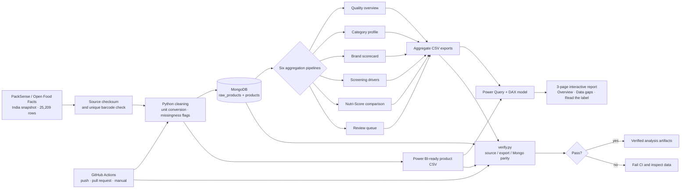

# Workflow and automation

The source snapshot is versioned with the project. A GitHub Actions workflow rebuilds MongoDB collections and all six exports on every push or pull request, then runs the consistency checks. Power BI refresh and publication remain owner-controlled in the workspace.

## Rebuild sequence

1. `build.py` checks barcode uniqueness, cleans fields, and replaces the two MongoDB collections.
2. `aggregations.py` runs six named pipelines and writes aggregate CSVs.
3. `build.py` writes the full product export and computed metrics.
4. `verify.py` checks the source hash, row and barcode parity, screen invariants, MongoDB counts, and aggregation totals.
5. Power BI uses `power_query.m` and the DAX measures for interactive exploration. The dashboard includes visible caveats because total sugar and total fat only approximate the added values required by the cited guidelines.
